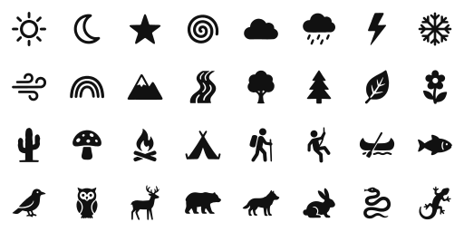
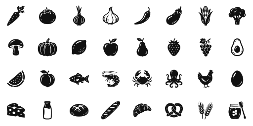
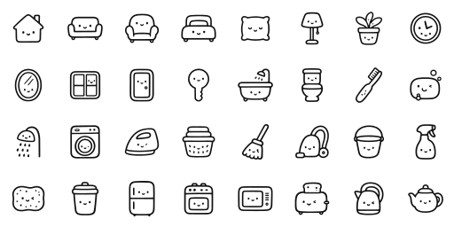

# Artifisio Icons

**[Browse the gallery → artifisio.github.io/icons](https://artifisio.github.io/icons/)**

15 sets, 960 open-licensed SVG icons. Search every icon by name, recolour a set, then install it with one command.

## Featured

<table>
<tr>
<td align="center" valign="top" width="33%">
<a href="sets/petroglyph-trail"></a>
<br /><br />
<strong><a href="sets/petroglyph-trail">Petroglyph Trail</a></strong><br />
<sub>62 icons · 24px grid · 2px stroke · 1 themeable colour</sub><br /><br />
<code>npx artifisio add petroglyph-trail --kind icon</code>
</td>
<td align="center" valign="top" width="33%">
<a href="sets/linocut-market"></a>
<br /><br />
<strong><a href="sets/linocut-market">Linocut Market</a></strong><br />
<sub>62 icons · 24px grid · 2px stroke · 1 themeable colour</sub><br /><br />
<code>npx artifisio add linocut-market --kind icon</code>
</td>
<td align="center" valign="top" width="33%">
<a href="sets/housemates"></a>
<br /><br />
<strong><a href="sets/housemates">Housemates</a></strong><br />
<sub>62 icons · 24px grid · 2px stroke · 1 themeable colour</sub><br /><br />
<code>npx artifisio add housemates --kind icon</code>
</td>
</tr>
</table>

## All sets (15)

| Set | Slug | Details | Tags |
| --- | ---- | ------- | ---- |
| [Petroglyph Trail](sets/petroglyph-trail) | `petroglyph-trail` | 62 icons · 24px grid · 2px stroke · 1 themeable colour | petroglyph, outdoors, primitive, solid |
| [Linocut Market](sets/linocut-market) | `linocut-market` | 62 icons · 24px grid · 2px stroke · 1 themeable colour | linocut, food, handmade, solid |
| [Housemates](sets/housemates) | `housemates` | 62 icons · 24px grid · 2px stroke · 1 themeable colour | kawaii, home, cute, outline |
| [Kitchen Alchemy](sets/kitchen-alchemy-ii) | `kitchen-alchemy-ii` | 14 icons · 24px grid · 2px stroke · 2 themeable colours | kitchen, cooking, whimsical, duotone |
| [Bitmap](sets/bitmap-3) | `bitmap-3` | 34 icons · 24px grid · 2px stroke · 1 themeable colour | pixel, retro, lo-fi, solid |
| [Gaffer](sets/gaffer-2) | `gaffer-2` | 33 icons · 24px grid · 2px stroke · 3 themeable colours | tape, collage, handmade, duotone |
| [Bitmap](sets/bitmap-2) | `bitmap-2` | 34 icons · 24px grid · 2px stroke · 1 themeable colour | pixel, retro, lo-fi, solid |
| [Pulse](sets/pulse) | `pulse` | 142 icons · 24px grid · 2px stroke · 1 themeable colour | health, medical, wellness, outline |
| [Constellation](sets/constellation) | `constellation` | 142 icons · 24px grid · 2px stroke · 1 themeable colour | stars, night, celestial, outline |
| [Stack](sets/stack) | `stack` | 141 icons · 24px grid · 2px stroke · 1 themeable colour | developer, cloud, data, outline |
| [Cross Stitch · GPT Image 2](sets/cross-stitch-gpt2) | `cross-stitch-gpt2` | 34 icons · 24px grid · 2px stroke · 1 themeable colour | embroidery, stitch, cosy, outline, gpt2 |
| [Whiskers](sets/whiskers) | `whiskers` | 34 icons · 24px grid · 2px stroke · 1 themeable colour | cat, pets, playful, outline, gpt2 |
| [Meltdown · GPT Image 2](sets/meltdown-gpt2) | `meltdown-gpt2` | 34 icons · 24px grid · 2px stroke · 1 themeable colour | melting, liquid, playful, ui, gpt2 |
| [Drafting Table · Nano Banana 2 (Flash)](sets/drafting-table-nb2) | `drafting-table-nb2` | 34 icons · 24px grid · 2px stroke · 3 themeable colours | blueprint, technical, engineering, duotone, nb2 |
| [UI Essentials](sets/ui-essentials) | `ui-essentials` | 98 icons · 24px grid · 2px stroke · 1 themeable colour | ui, outline, essentials |

Each set folder has a README, its files and a `meta.json` with the sha256 of every file.

## Install

```bash
# Find a set
npx artifisio search "<vibe>" --kind icon

# Add it to your project (files + ATTRIBUTION.md)
npx artifisio add <set> --kind icon

# Recolour at install time
npx artifisio add <set> --kind icon --colors "ink=#4A7CFF"

# Update installed sets
npx artifisio update <set>
```

`add` pins each set's registry `version` and `manifestHash` in `.artifisiorc.json` for reproducible installs. Icons land in `./public/icons/<set>/` with a typed index.

## CDN (jsDelivr)

```html
/svg/<icon>.svg" width="24" />
```

Swap `@main` for a release tag such as `@v2026.10.27-2125-36700ff` to pin it.

## Theming

Mono sets carry one themeable `ink` slot, drawn as `fill="var(--artf-ink, currentColor)"`: they follow the text colour, or one CSS variable:

```css
.icon { color: #334155; }              /* inherited via currentColor */
.icon-brand { --artf-ink: #4A7CFF; }   /* or override the slot directly */
```

Duotone sets add measured `accent-*` slots; each set's `meta.json` `palette` lists them.

## License

All icons here are licensed under [CC BY 4.0](LICENSE): use them commercially, modify them and redistribute them, keeping the credit. Attribution text lives in every set's `license.attribution`; `npx artifisio add` writes it to `ATTRIBUTION.md` for you.

## Registry details

| Field | Value |
| --- | --- |
| Registry version | `2026.10.27-2125-36700ff` |
| CLI | [`artifisio`](https://www.npmjs.com/package/artifisio) |
| License | [CC BY 4.0](LICENSE) |
| Other kinds | [`index.json`](index.json) lists every per-kind registry (illustrations, fonts) |
| For agents | [`llms.txt`](llms.txt) |

Generated and curated at [artifisio.com](https://artifisio.com) and published by its sync pipeline: pull requests get overwritten, so please [open an issue](../../issues) instead.
