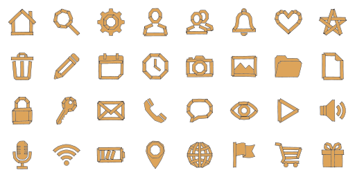

# Gaffer

**[Open in the gallery →](https://artifisio.github.io/icons/gaffer-2/)**

Every icon torn from tape and pressed down by hand — straight strips at crooked angles, ragged ends and honest overlaps.

<p>
<a href="https://artifisio.github.io/icons/gaffer-2/"></a>
</p>

33 icons · 24px grid · 2px stroke · 3 themeable colours · [CC-BY-4.0](https://creativecommons.org/licenses/by/4.0/)

## Install

```bash
npx artifisio add gaffer-2 --kind icon
```

Recolour at install time; themeable slots: `ink`, `accent-1`, `accent-2`.

```bash
npx artifisio add gaffer-2 --kind icon --colors "ink=#4A7CFF"
```

---

Part of the [Artifisio icons registry](../../README.md). Credit: Icons by Artifisio (https://artifisio.com); `add` writes it to `ATTRIBUTION.md`. `meta.json` lists every file with its sha256.
