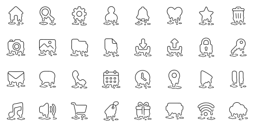

# Meltdown · GPT Image 2

**[Open in the gallery →](https://artifisio.github.io/icons/meltdown-gpt2/)**

A UI icon family caught mid-melt — every glyph sags, pools and drips, for festival, summer and heatwave products.

<p>
<a href="https://artifisio.github.io/icons/meltdown-gpt2/"></a>
</p>

34 icons · 24px grid · 2px stroke · 1 themeable colour · [CC-BY-4.0](https://creativecommons.org/licenses/by/4.0/)

## Install

```bash
npx artifisio add meltdown-gpt2 --kind icon
```

Recolour at install time; themeable slots: `ink`.

```bash
npx artifisio add meltdown-gpt2 --kind icon --colors "ink=#4A7CFF"
```

---

Part of the [Artifisio icons registry](../../README.md). Credit: Icons by Artifisio (https://artifisio.com); `add` writes it to `ATTRIBUTION.md`. `meta.json` lists every file with its sha256.
